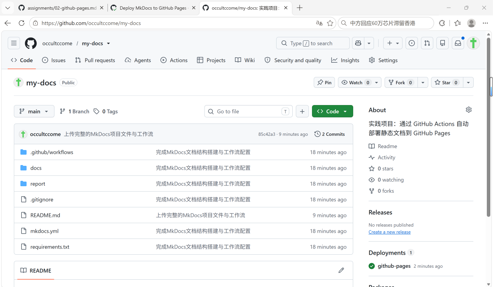
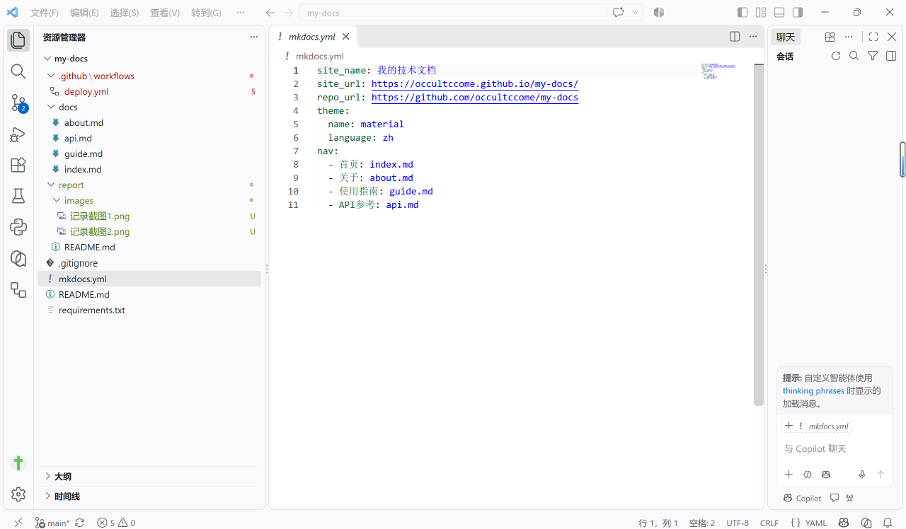
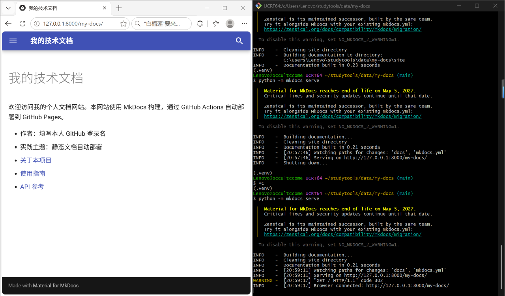
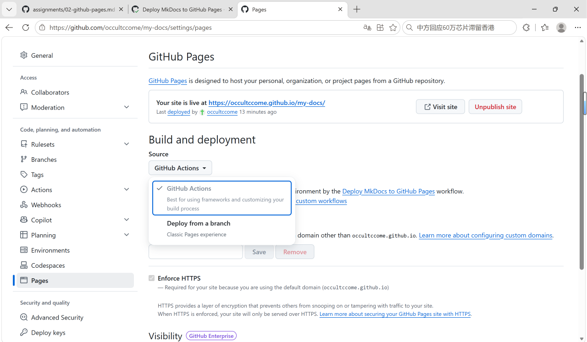
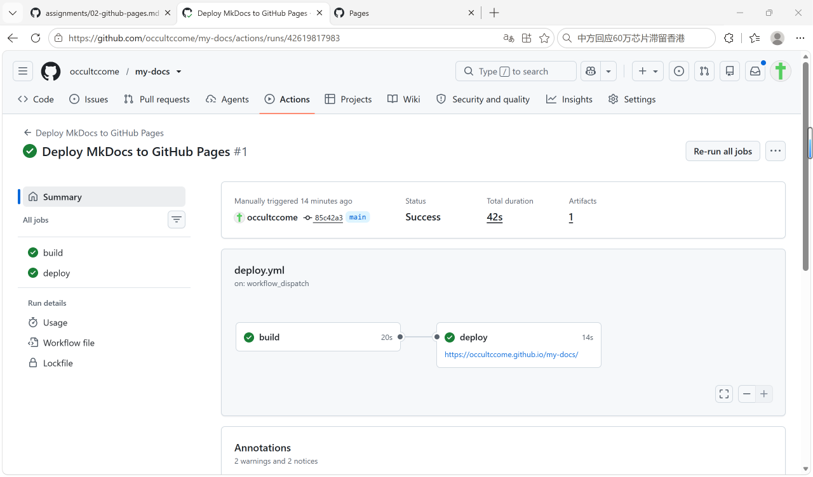
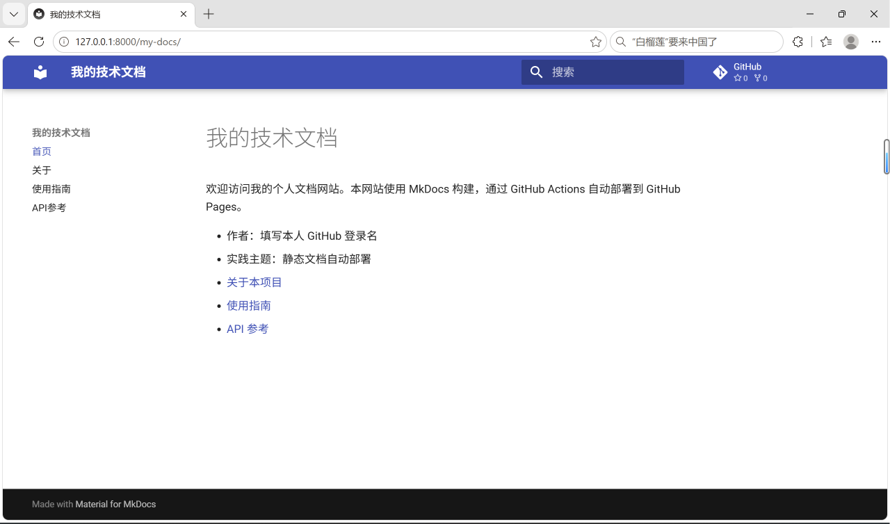
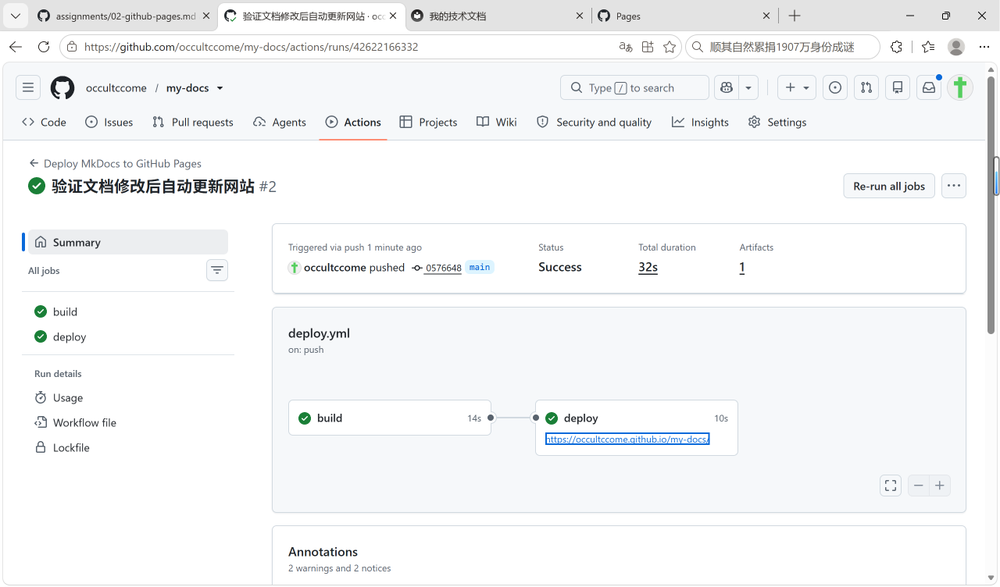
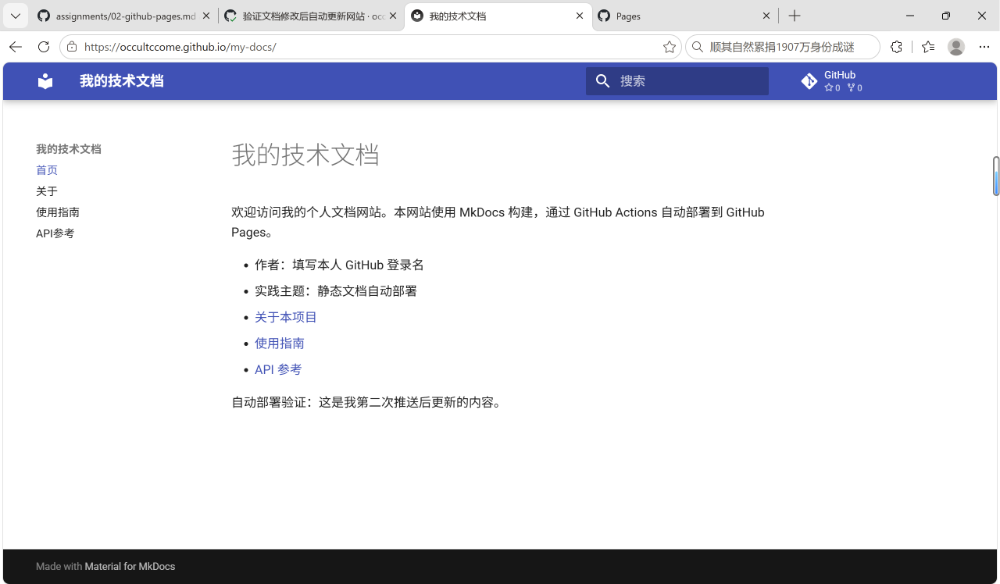

# 实践项目2：个人实验报告

## 1. 基本信息
- GitHub 登录名：occultccome
- 个人仓库地址：https://github.com/occultccome/my-docs
- 最终网站地址：https://occultccome.github.io/my-docs/

## 2. 实践过程与关键截图

### 2.1 仓库创建
我在 GitHub 上创建了名为 `my-docs` 的公开仓库，并克隆到本地进行后续操作。
 

### 2.2 项目结构与 MkDocs 配置
项目根目录下建立了 `docs/` 存放文档源码，`mkdocs.yml` 作为配置文件设置了网站名称、导航栏和主题。`site/` 目录是由 MkDocs 自动生成的，不需要手工修改，因此将其加入了 `.gitignore` 忽略列表。

### 2.3 本地构建或预览
我在本地使用 Python 虚拟环境安装了依赖，执行了 `mkdocs build --strict` 并在本地通过 `mkdocs serve` 预览了网站。我逐个检查了四个页面的导航、表格和代码块，均显示正常。

### 2.4 Pages 设置
在个人仓库的 `Settings` -> `Pages` 中，将发布来源（Source）设置为了 `GitHub Actions`。

### 2.5 Actions 首次构建和部署
在推送代码并配置好工作流后，我在 Actions 页面手动触发了第一次运行，`build` 和 `deploy` 均成功完成，网站成功发布。

### 2.6 网站访问与四页导航检查
通过部署成功后提供的网址访问了公开网站，检查了首页、关于、使用指南和 API 参考，所有导航链接及资源加载正常。

### 2.7 第二次推送与自动更新验证
修改了 `docs/index.md` 的内容并推送到 `main` 分支，Actions 自动触发了新一轮的构建和部署。刷新网页后看到了新增的内容，证明自动更新链路无误。

- 对应提交链接：https://github.com/occultccome/my-docs/commits/main
- 对应 Actions 运行链接：https://github.com/occultccome/my-docs/actions

## 3. 问题与解决
在操作过程中遇到了仓库名称拼写错误以及工作流文件推送到 GitHub 时未能成功识别的问题。通过核对 GitHub 账号拼写 `occultccome`，并使用 Git Bash 执行 `git add -A` 强制添加所有文件，重新提交并推送后，成功触发了 Actions 自动部署。没有遇到其他错误。

## 4. 原理理解
1. **docs/ 和 site/ 各保存什么？为什么不用手工修改 site/？**
   - `docs/` 保存的是 Markdown 源代码，是我们手写的内容；`site/` 保存的是 MkDocs 将 Markdown 转换后生成的 HTML/CSS/JS 静态网页文件。
   - 不需要手工修改 `site/`，因为它是自动生成的产物，每次修改 `docs/` 后都会重新生成并覆盖，手工修改会丢失。

2. **本次工作流在什么情况下自动运行？**
   - 根据配置，当代码被 `push` 到 `main` 分支，且修改了 `docs/`、`mkdocs.yml`、`requirements.txt` 或工作流配置文件本身时，会自动运行；也可以在 Actions 页面手动触发（`workflow_dispatch`）。

3. **build 与 deploy 两个任务有什么区别？**
   - `build` 任务负责拉取代码、安装环境、编译 Markdown 并打包生成 `site/` 产物；`deploy` 任务是将打包好的产物正式发布到 GitHub Pages 服务器上，供用户访问。`deploy` 依赖于 `build` 的成功。

4. **只修改 report/README.md 会触发部署吗？为什么？**
   - 不会。因为工作流配置中的 `paths` 限定了只有修改特定路径（如 `docs/**`）时才触发。修改 `report/` 目录下的文件不会改变网站的实际内容，因此不需要重新部署。

5. **本次方案为何无需创建 gh-pages 分支？**
   - 官方推荐的 Pages Actions 方案通过 OIDC 令牌直接授权部署。构建后的产物通过 `upload-pages-artifact` 上传，并由 `deploy-pages` 直接部署到 GitHub Pages 环境中，不需要像以前那样强制推送到 `gh-pages` 分支来托管。